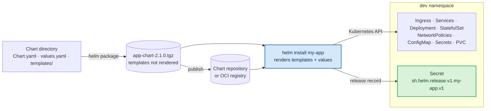

#helm #kubernetes #templating

# The role of Helm in Kubernetes

Kubernetes manages objects.
A Deployment, a Service, and a Secret are each created, updated, and deleted on their own, and the API has no object that stands for the application they make up together.
The Kubernetes documentation states this directly:

> *"Kubernetes is not a platform as a service (PaaS) and doesn't have or enforce a formal notion of an application. Instead, applications are informal and described with metadata."*

Helm supplies that unit.
It groups an application's manifests into one versioned package, a **chart**, and tracks every installation of that chart as one **release** that we upgrade, roll back, and remove with a single command.

## What one application is made of

A small web application with a database already spans eleven objects in one namespace:

| Object | Role | How it refers to the others |
|---|---|---|
| `Ingress` | routes external HTTP(S) traffic into the cluster | names the app `Service` in its rules, and a TLS `Secret` in `spec.tls` |
| TLS `Secret` | the certificate and private key the Ingress terminates TLS with | referenced by name |
| `Service` (app) | a stable address in front of the app Pods | label selector over the Pod labels |
| `Deployment` | runs the application Pods | `spec.selector` over its own Pod template labels |
| `NetworkPolicy` (app) | restricts traffic to the app Pods | `podSelector` over the Pod labels |
| `Service` (database) | a stable address in front of the database Pod | label selector |
| `StatefulSet` | runs the database Pod | `spec.selector` over its Pod template labels |
| `NetworkPolicy` (database) | admits traffic to the database only from the app Pods | `podSelector`, plus a `from` rule matching the app Pod labels |
| `ConfigMap`, `Secret` | configuration and credentials for both workloads | referenced by name from the Pod specs |
| `PersistentVolumeClaim` | the database's storage | referenced by name from the StatefulSet |

Two mechanisms hold all of this together: **names** and **labels**.
Names connect an Ingress to a Service or a Pod to a ConfigMap.
Labels connect everything that selects Pods:

> *"The label selector is the core grouping primitive in Kubernetes."*

**Kubernetes accepts each object on its own:** the API server validates an object against its schema, not against the other objects it is supposed to match.
A Service whose selector matches no Pod is a valid Service.

Its controller *"continuously scans for Pods that match its selector, and then makes any necessary updates to the set of EndpointSlices for the Service"* — and when nothing matches, that set is empty and the Service has no endpoints to route traffic to.

## Problems with managing each manifest separately

### Relationships held together by labels and names

Changing the app Pods' labels means changing every object that selects them, in the same rollout:

- the Deployment's own `spec.selector` — which cannot be edited in place: *"Also note that `.spec.selector` is immutable after creation of the Deployment in `apps/v1`."*
- the app Service's selector — a missed one routes traffic to no Pods
- the app NetworkPolicy's `podSelector` — a missed one stops selecting the Pods, and *"By default, a pod is non-isolated for ingress; all inbound connections are allowed."* The Pods lose their restriction silently.
- the database NetworkPolicy's `from` rule — a missed one rejects the app's traffic, and the application fails against its own database

Each object is still valid on its own.
The failure exists only in the relationship between them, which nothing in Kubernetes checks.

### Manual edits repeat the same value in many places

The same value appears in several manifests: a name, a label, a port, an image tag.
Editing it by hand in each one leaves room for typos, mismatched names, and edits applied to some files but not others.

`kubectl apply` validates each manifest against its schema by default (`--validate=strict`), but a correct schema with the wrong value passes validation.
A wrong value in an RBAC binding, a NetworkPolicy, or a Secret reference is a security problem, not only an outage.

### Each environment is another copy

The same application deployed to `dev`, `staging`, and `prod` differs in a few fields: replica counts, image tags, host names, resource limits.
Copying the manifests per environment duplicates everything to change those few fields, and the copies drift apart.

Kustomize addresses this without templates: *"`kustomize` lets you customize raw, template-free YAML files for multiple purposes, leaving the original YAML untouched and usable as is."*
A base holds the shared manifests and an overlay patches it per environment.

Being template-free, it has no conditionals and no loops: an object is either in the base or overlay or it is not, and ten similar objects are written out ten times.

### History exists per Deployment, not per application

Kubernetes keeps rollout history for Deployments, but only for their Pod template:

> *"A Deployment's revision is created when a Deployment's rollout is triggered. This means that the new revision is created if and only if the Deployment's Pod template (`.spec.template`) is changed […]. This means that when you roll back to an earlier revision, only the Deployment's Pod template part is rolled back."*

ConfigMaps, Secrets, Services, NetworkPolicies, and Ingresses have no revision history at all.
`kubectl rollout undo` reverts one Deployment's Pod template; there is no operation that returns the whole application, every object together, to the state it was in before a change.

## What Helm adds

> *"Helm is the package manager for Kubernetes. It helps you define, install, and upgrade applications on a Kubernetes cluster, from a single container to an application with many interdependent parts."*

The documentation describes the unit it introduces: *"Helm packages these related manifests into a single unit called a chart, which you can version, share, install, and roll back as one release."*

The documentation names three concepts:

| Concept | Definition |
|---|---|
| **Chart** | *"A chart is a Helm package. It contains all of the resource definitions needed to run an application, tool, or service inside a Kubernetes cluster."* |
| **Repository** | *"A repository is the place where charts are collected and shared."* Public charts are listed on Artifact Hub. Container registries with OCI support store and share charts as well. |
| **Release** | *"A release is an instance of a chart running in a Kubernetes cluster. You can install one chart many times into the same cluster, and each installation creates a new release with its own release name."* |

A fourth input, the **values**, turns a chart into a release: *"To create a release, Helm merges a packaged chart with configuration information."*

### Where the package-manager comparison holds

The documentation draws the comparison itself: a chart is *"the Kubernetes equivalent of a Homebrew formula, an apt `dpkg`, or a yum RPM file."*
As with those tools:

- packages are versioned, searchable, and installed by name from a repository
- one command installs, upgrades, or removes everything the package contains
- a package declares the other packages it depends on

### Where it differs

**Dependencies are stored inside the chart:** an operating-system package manager resolves dependencies on the target machine at install time.

A chart lists its dependencies in `Chart.yaml`, and *"When `helm dependency update` retrieves charts, it will store them as chart archives in the `charts/` directory."*
`helm template`, `helm install`, and `helm package` all refuse a chart whose listed dependencies are missing from `charts/` (`helm install --dependency-update` fetches them first), so a packaged chart carries its dependencies inside the archive.

**One chart installs many times:** an operating-system package is installed once per machine.
A chart is installed once per release, so two releases of the same PostgreSQL chart in one cluster are two independent databases.

**Configuration is part of each installation:** every release combines the chart with its own values, so the same chart version runs differently in `dev` and `prod` without a second copy of any manifest.

## Templates and values

Manifests in a chart are templates, rendered to plain YAML before anything reaches the API server:

> *"Helm Chart templates are written in the Go template language, with the addition of 50 or so add-on template functions from the Sprig library and a few other specialized functions."*

Go's `text/template` package defines the mechanism: *"Templates are executed by applying them to a data structure."*
Everything between `{{` and `}}` is evaluated against that data — the values, the release, the chart's metadata — and *"all text outside actions is copied to the output unchanged."*

Templating removes the label problem from the previous section.
`helm create` defines the selector labels once, as a named template in `templates/_helpers.tpl`:

```yaml
{{- define "app-chart.selectorLabels" -}}
app.kubernetes.io/name: {{ include "app-chart.name" . }}
app.kubernetes.io/instance: {{ .Release.Name }}
{{- end }}
```

The Deployment's `spec.selector`, its Pod template, and the Service's selector all include that one definition:

```yaml
  selector:
    {{- include "app-chart.selectorLabels" . | nindent 4 }}
```

Every object renders the same labels from the same source, so they cannot drift apart.
Installed as release `my-app`, the Service's selector renders to:

```yaml
  selector:
    app.kubernetes.io/name: app-chart
    app.kubernetes.io/instance: my-app
```

The `instance` label carries the release name, which is what keeps two releases of the same chart from selecting each other's Pods.

**Values supply what changes between installations:** the chart's `values.yaml` holds the defaults, and *"When a user supplies custom values, these values will override the values in the chart's `values.yaml` file."*
An environment becomes a values file rather than a copy of the manifests:

```bash
helm install my-app ./app-chart -f values-prod.yaml --namespace prod
```

Several `-f` files may be given: *"The priority will be given to the last (right-most) file specified."*

## One version for the whole application

A chart's version covers every manifest in it, not a single file:

- *"Every chart must have a version number."* It follows Semantic Versioning 2.
- *"Packages in repositories are identified by name plus version."* Version `2.1.0` of `app-chart` is the archive `app-chart-2.1.0.tgz`.
- `appVersion` records the version of the application inside the chart, separately: *"This field is informational, and has no impact on chart version calculations."*

Installing `app-chart` `2.1.0` with the same values produces the same set of objects every time, unless its templates read from the cluster or generate random values such as passwords.
That is what makes the chart version, rather than any single manifest, the unit we test, promote between environments, and roll back to.

## From chart to release



**`helm package` archives the chart and renders nothing:** *"This command packages a chart into a versioned chart archive file."*
The `.tgz` holds `Chart.yaml`, `values.yaml`, and the templates exactly as written, `{{ }}` included.
Rendering happens later, once per installation, because only then are the release name and the values known.

**`helm install` accepts the chart in several forms:** a chart reference such as `example/mariadb`, a path to a packaged chart, a path to an unpacked chart directory, an absolute URL, a chart name with `--repo`, or an `oci://` reference.

```bash
helm install my-app ./app-chart-2.1.0.tgz --namespace dev --create-namespace
```

`--namespace` sets where the release record lives, and where every namespaced object that does not set its own namespace is created.
The namespace must already exist unless `--create-namespace` is given — *"create the release namespace if not present"*.

**The command returns before the application is running:** *"Helm does not wait until all of the resources are running before it exits."*
Pulling images and starting Pods continues after the prompt returns.
Making the command wait for readiness is a separate choice, made with `--wait`.

### How Helm reaches the cluster

Helm has no component of its own inside the cluster.
The introduction to Helm's documentation describes the architecture:

> *"Helm is a command-line tool that runs on your local machine and talks to the Kubernetes API server."*

The Helm client hands charts to the Helm library, and *"the library uses the Kubernetes client library to communicate with Kubernetes over REST and JSON."*
Templates are rendered on our machine, and the API server receives the rendered objects and the release record.
*"Helm stores release information in Kubernetes Secrets inside the cluster, so it does not need its own database."*

**The kubeconfig selects the cluster and the credentials:** *"The Helm client learns about Kubernetes clusters by using files in the Kube config file format. By default, Helm attempts to find this file in the place where `kubectl` creates it (`$HOME/.kube/config`)."*

Helm uses the same file and current context as `kubectl`, with its own overrides: `--kubeconfig` or `KUBECONFIG` for the file, `--kube-context` or `HELM_KUBECONTEXT` for the context, and `--namespace` or `HELM_NAMESPACE` for the namespace.

**Helm acts with our own permissions:** Kubernetes RBAC authorizes every request Helm sends as the user in the kubeconfig.
A user who may only manage objects in one namespace can install only charts whose objects all live in that namespace.

**Each Helm version supports a range of Kubernetes versions:** *"As of Helm 4, Helm is assumed to be compatible with `n-3` versions of Kubernetes it was compiled against."*
`helm version` shows that version: Helm 4.3.1 reports `KubeClientVersion:"v1.37"`, and the version skew table lists `1.37.x - 1.34.x` for Helm 4.3.x.

### The release record

Helm keeps the state of each release in the cluster:

> *"By default, release information is stored in Secrets in the namespace of the release."*

Helm's source names that Secret `sh.helm.release.v1.<release>.v<revision>` and labels it `owner=helm`, with `name`, `status`, and `version` among its other labels.

The source of Helm 3.22.1 and Helm 4.3.1 defines the same storage type, `sh.helm.release.v1`, so Helm 4 also lists, upgrades, and rolls back releases that Helm 3 created.
Those releases keep client-side apply: *"all releases created by Helm 3 will default to using client-side apply after upgrading to Helm 4."*

One Secret is written per revision:

| Operation | Revision | Runs |
|---|---|---|
| `helm install` | 1 | chart and values of the install |
| `helm upgrade` | 2 | the new chart or values |
| `helm upgrade` | 3 | the newer chart or values |
| `helm rollback my-app 1` | 4 | the same chart and values as revision 1 |

*"Importantly, a rolled back release will receive a new release number."*
A rollback does not delete history; it records a new revision whose contents match an old one.

This is the history Kubernetes does not keep: a revision covers every object the chart rendered, ConfigMaps and Services included, not only a Deployment's Pod template.
**A revision holds manifests, not data:** rolling back restores the chart and values, not the contents of a database volume.

**The record contains the values, secrets included:** *"The release information includes the contents of charts and values files, and therefore might contain sensitive data (like passwords, private keys, and other credentials) that needs to be protected from unauthorized access."*
Read access to Secrets in a namespace includes read access to every value passed to every release in it.

### Tests run against a release

A chart can ship tests: workload definitions under `templates/` annotated `helm.sh/hook: test`.
`helm test <release>` runs them against the installed release, and *"The container should exit successfully (exit 0) for a test to be considered a success."*

## The four problems, with and without Helm

| Problem | Kubernetes manifests alone | With Helm |
|---|---|---|
| Objects linked by labels and names | every copy of a label kept in sync by hand | labels and names defined once in a named template and included everywhere |
| Hand-edited, repeated values | each occurrence edited separately | one value in `values.yaml`, rendered into every template that uses it |
| One copy per environment | duplicated manifests, or Kustomize overlays without conditionals or loops | one chart, one values file per environment, conditionals and loops in the templates |
| History and rollback | rollout history for Deployment Pod templates only | one revision per install, upgrade, or rollback, covering every object in the release |
