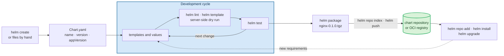

#helm #kubernetes

# The chart development workflow

Creating a chart's files is a short step at the start of a longer cycle.
A chart is scaffolded once, then developed, checked, and tested over many versions, and each version is packaged, published, and installed from a repository.



## Starting a chart

`helm create` generates the common files: *"This command creates a chart directory along with the common files and directories used in a chart."*
The scaffold includes a Deployment, a Service, a ServiceAccount, optional Ingress, HTTPRoute, and HorizontalPodAutoscaler templates, a test Pod, and named templates in `_helpers.tpl`.

**For traffic from outside the cluster, the scaffold offers two templates:** an Ingress, and an HTTPRoute from the Gateway API, both off by default.
Ingress is stable and still widely used, while the Kubernetes documentation recommends Gateway: *"The Kubernetes project recommends using Gateway instead of Ingress. The Ingress API has been frozen."*
Which one to enable depends on the controller the cluster runs.

A chart can also start from hand-written files: only `Chart.yaml` is required (see **22 - Helm chart structure**).
With `--starter`, `helm create` copies a starter chart instead of the built-in scaffold, which is one way to carry an organization's standards into every new chart (see **21 - Why create our own charts**).

## The development cycle

Most of a chart's life is spent here: writing templates, choosing which settings become values, and documenting them (see **23 - Template syntax basics** and **24 - Values and release information in a chart**).
Each change goes through the same checks before it's published.

### Checking a change

The three checks differ in what they read and whether they reach the cluster:

| Check | Command | What it catches | Contacts the cluster |
|---|---|---|---|
| Lint | `helm lint ./chart` | `Chart.yaml` fields, template and YAML syntax, best-practice warnings | no |
| Render | `helm template ./chart` | the exact manifests, with the values merged in | no |
| API validation | `helm template ./chart \| kubectl apply --dry-run=server -f -` | field names, types, and object rules the API server enforces | yes |

`helm lint` *"runs a series of tests to verify that the chart is well-formed."*
`helm template` renders without a cluster: *"Any values that would normally be looked up or retrieved in-cluster will be faked locally. Additionally, none of the server-side testing of chart validity (e.g. whether an API is supported) is done."*

**Lint and Helm's own dry run miss object errors:** on Helm 4.3.2, a misspelled field (`replica:` instead of `replicas:`) and Pod labels that don't match a Deployment's selector both pass `helm lint`.
They also pass `helm install --dry-run=server`, which ends with `STATUS: pending-install`.

The API server rejects both once `kubectl apply --dry-run=server` sends it the objects:

```text
Deployment in version "v1" cannot be handled as a Deployment: strict decoding error: unknown field "spec.replica"
The Deployment "nginx" is invalid: spec.template.metadata.labels: Invalid value: {"app":"web"}: `selector` does not match template `labels`
```

### Tests

`helm test` runs a chart's tests against an installed release: *"The test command runs the tests for a release."*
The tests are workloads in `templates/` annotated `helm.sh/hook: test`, so they check the chart in a real cluster (see **22 - Helm chart structure**).

Template unit tests, which assert on the rendered output without a cluster, come from plugins such as helm-unittest.

## Packaging and publishing

`helm package` turns the chart directory into a versioned archive named after the chart, such as `nginx-0.1.0.tgz`, with the templates not rendered (see **01 - The role of Helm in Kubernetes**).
The archive's files are copied as they are, except `Chart.yaml`, which Helm writes from the parsed metadata with its fields in alphabetical order.

`--version` and `--app-version` set both versions for one package without editing `Chart.yaml`, and `--sign` adds a provenance file that `helm install --verify` checks (see **02 - Benefits and limitations of Helm**).

### Chart repositories

A chart repository is a web server that serves the archives and an index.
Helm's chart repository guide says *"A valid chart repository must have an index file."*
`helm repo index` writes that `index.yaml` from the archives in a folder.

The index records each chart version's `Chart.yaml` fields, a digest of the archive, and a download URL.
Without `--url`, the URL is relative, such as `nginx-0.1.0.tgz`, and Helm resolves it against the repository's URL, so the archives must be served next to `index.yaml`.

**One index covers every chart in the folder:** `helm repo index` also reads archives in subfolders and records their path in the URL, such as `sub/other-0.1.0.tgz`.
It indexes only packaged archives; an unpacked chart directory in the same folder is skipped.

**The index has to be regenerated for every new version:** *"The `helm repo index` command will completely rebuild the `index.yaml` file from scratch, including only the charts that it finds locally."*
`--merge` adds new archives to an existing index instead, for repositories whose older archives aren't available locally.

Any static web server can host a chart repository; GitHub Pages serving a branch of a public repository is a common free option.
Our repository, `https://maor-klir.github.io/helm-charts`, serves `index.yaml` and `nginx-0.1.0.tgz` from the root of its `main` branch.

### OCI registries

An OCI registry stores charts like container images, with no `index.yaml`.
`helm push` uploads the archive directly: *"Upload a chart to a registry. If the chart has an associated provenance file, it will also be uploaded."*

### Automating the release

In CI/CD, the same steps run on every change.
For GitHub Pages repositories, Helm's documentation describes the Chart Releaser Action: *"Chart Releaser Action is a GitHub Action workflow to turn a GitHub project into a self-hosted Helm chart repo, using helm/chart-releaser CLI tool."*

It keeps the chart sources on `main` and publishes from a separate branch: *"There should be another branch named `gh-pages` to publish the charts."*

## Installing and upgrading

Installing from a chart repository uses the same commands as for any public chart (see **11 - Exploring charts and releases with the Helm CLI**):

```bash
helm repo add maor-klir https://maor-klir.github.io/helm-charts
helm search repo maor-klir/
helm -n nginx install super-nginx maor-klir/nginx --create-namespace
```

`helm repo add` takes the repository's base URL and appends `/index.yaml` itself; a URL that already ends in `index.yaml` fails with `404 Not Found`.

## Each new version

Every change to a published chart becomes a new chart version, numbered by Semantic Versioning, with a new major version for a breaking change (see **02 - Benefits and limitations of Helm**).
A published version is never changed in place.

**Helm orders versions by SemVer, not as text:** an index with `0.9.0`, `0.10.0`, and `0.11.0-rc.1` lists `0.11.0-rc.1` first, then `0.10.0`, then `0.9.0`.
Without `--version`, `helm search repo` and `helm show chart` pick the newest stable version, `0.10.0`, and `--versions` lists only stable versions.

Pre-release versions appear only with `--devel`: *"use development versions (alpha, beta, and release candidate releases), too. Equivalent to version '>0.0.0-0'."*
Publishing a release candidate such as `0.11.0-rc.1` lets a version be tested before it becomes the default.

For each version, the cycle closes the same way:

1. Change the templates or values, and check them with `helm lint`, `helm template`, and a server-side dry run.
2. Raise `version` in `Chart.yaml`, and `appVersion` if the application changed.
3. Package the chart, add the archive to the repository, and regenerate `index.yaml`, or push it to an OCI registry.
4. Users run `helm repo update` to see the new version, then `helm upgrade` to move their releases to it (see **14 - Upgrading releases**).

## Verify

From the folder that holds our `creating-charts/nginx` chart, lint it and package it to a scratch folder:

```bash
helm lint creating-charts/nginx
helm package creating-charts/nginx -d /tmp
tar tzf /tmp/nginx-0.1.0.tgz
```

The published repository lists the chart, and its index points to the archive with a relative URL:

```bash
helm repo update maor-klir
helm search repo maor-klir/
curl -s https://maor-klir.github.io/helm-charts/index.yaml | grep -A1 'urls:'
```

The API server catches what lint misses; a server-side dry run of the rendered chart reports `created (server dry run)` for each object:

```bash
helm template creating-charts/nginx | kubectl -n default apply --dry-run=server -f -
```
