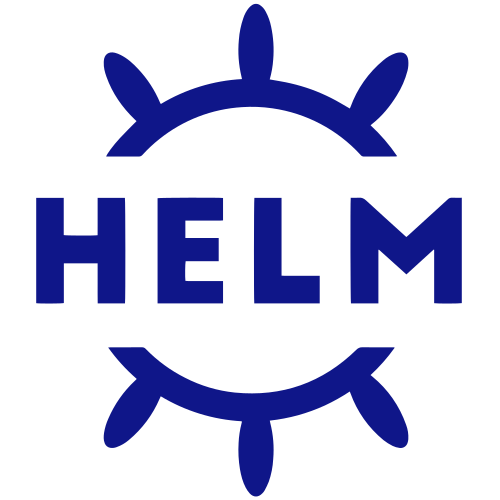

<h1 align="center">At the Helm</h1>

  <picture>
    <source media="(prefers-color-scheme: dark)" srcset=".github/assets/helm-horizontal-white.svg">
    
  </picture>

My work through Lauro Müller's [Helm: The Definitive Guide from Beginner to Master](https://www.udemy.com/course/definitive-helm-course-beginner-master) on Udemy, adapted to Helm 4.

## Layout

- `00-notes/`: one note per topic, numbered by section (0x introduction, 1x fundamentals, 2x creating charts, 3x Go templating, 4x config-store project, 5x subcharts, 6x advanced topics).
- One folder per course section, such as `01-helm-fundamentals/`, with one folder per lesson inside. A lesson folder holds the lab, `<NN-lesson>.md`, and, where the lesson changes code, the chart as it stands at the end of that lesson. Run a lab's commands from its folder.
- `04-config-store-project/` holds only labs; the application's code is in [maor-klir/config-store](https://github.com/maor-klir/config-store).

## Setup the labs assume

- Helm 4; the course was recorded with Helm 3.
- A k3s cluster run with k3d, `k3d-argocd`, reached with `kubectl port-forward`.
- Bitnami's versioned images from `docker.io/bitnamilegacy`, where Bitnami moved them.
